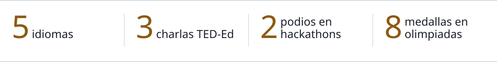
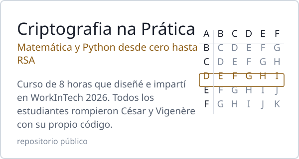
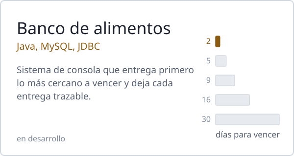
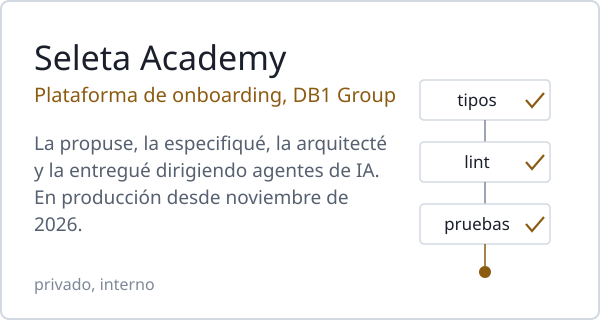
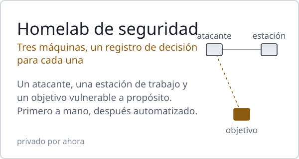

<picture><source media="(prefers-color-scheme: dark)" srcset="assets/es/header-dark.svg"></picture>

<a href="https://github.com/BrunoFernandesO">English</a> · <a href="https://github.com/BrunoFernandesO/BrunoFernandesO/blob/main/README.pt-BR.md">Português</a> · <b>Español</b> 
<a href="https://www.linkedin.com/in/bruno-fernandes-ortega">LinkedIn</a> · <a href="http://lattes.cnpq.br/2238488248240559">Lattes</a>

Nací en Chile y he vivido en Chile, Estados Unidos y Brasil. Diseño sistemas, dirijo agentes de IA para construirlos y enseño lo que aprendo.

<picture><source media="(prefers-color-scheme: dark)" srcset="assets/es/facts-dark.svg"></picture>

### Trabajos destacados

<a href="https://github.com/BrunoFernandesO/CTF-Cryptography"><picture><source media="(prefers-color-scheme: dark)" srcset="assets/es/card-course-dark.svg"></picture></a>
<a href="https://github.com/BrunoFernandesO/banco-de-alimentos-aep"><picture><source media="(prefers-color-scheme: dark)" srcset="assets/es/card-foodbank-dark.svg"></picture></a>
<picture><source media="(prefers-color-scheme: dark)" srcset="assets/es/card-academy-dark.svg"></picture>
<picture><source media="(prefers-color-scheme: dark)" srcset="assets/es/card-homelab-dark.svg"></picture>

### Ahora

- Estudiando álgebra lineal como parte de mi preparación para un magíster.
- Avanzando en las rutas de TryHackMe y armando el homelab de arriba, un registro de decisión a la vez.

### Experiencia

- **Practicante de Operaciones de Marketplace**, Marca Seleta · DB1 Group (oct. 2025 – presente). Gestiono de punta a punta la cartera de clientes LATAM de habla hispana, construí una automatización de precios para marketplaces en n8n y encontré y corregí fallas de seguridad en una aplicación interna de IA.
- **Dirección Científica**, Axion, organización estudiantil de tecnología de UniCesumar. Coorganicé WorkInTech 2026 (más de 300 asistentes) y represento a Ingeniería de Software en actividades con estudiantes de enseñanza media.
- **Fundador**, UniEnglish, programa semanal de conversación en inglés para estudiantes (más de 15 participantes).
- **Miembro**, Liga Azul de Robótica, proyecto de extensión en robótica de UniCesumar.

### Reconocimientos

- 2.º lugar entre 30 equipos, Hackathon UniCesumar × Elotech 2026 (líder del equipo)
- 2.º lugar entre 22 equipos, 6.º Hackathon Inova Agro 2025 (líder del equipo)
- Beca completa en UniCesumar, obtenida por olimpiadas científicas nacionales; oro en la Olimpíada Nacional de Ciências (ONC)
- Certificado de Desempeño Académico, UniCesumar (2026)
- AI First Certification, DB1 Group (2026)
- Charlas TED-Ed: [idiomas e identidad](https://youtu.be/3qbNDMw_4qs) (2024), [la evolución de los modelos atómicos](https://www.youtube.com/watch?v=iRVyXAUh6aY) (2022), [Darwin y la teoría de la evolución](https://www.youtube.com/watch?v=YqmxHsZdLtg) (2021, en español)

### Herramientas

Java · C · SQL · HTML · CSS · JavaScript · Linux · Git 
También automatizo flujos con n8n y desarrollo con agentes de IA (Claude Code) a partir de especificaciones y registros de decisión escritos.

Los gráficos de esta página se generan con [`tools/build_assets.py`](tools/build_assets.py) y están compuestos en Latin Modern, la tipografía de LaTeX.
