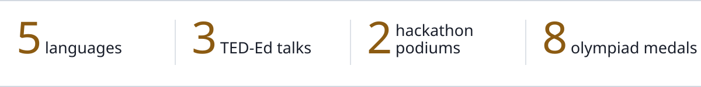
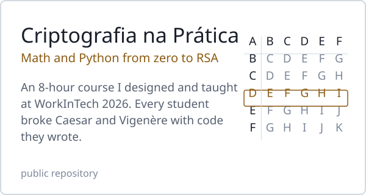
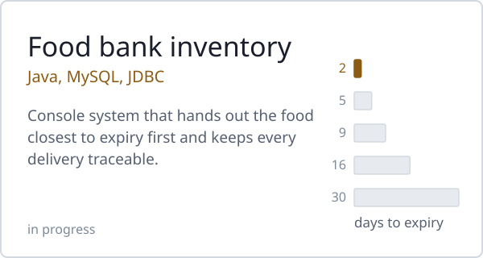
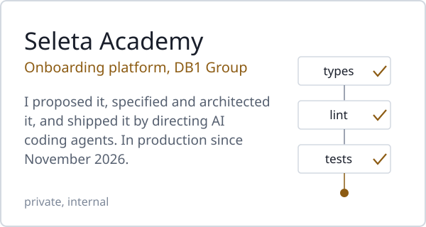
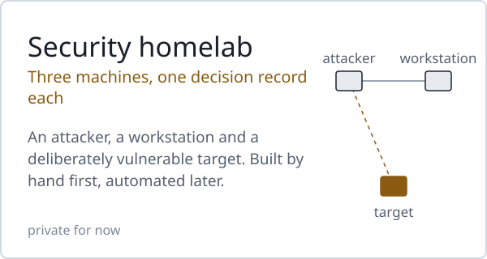

<picture><source media="(prefers-color-scheme: dark)" srcset="assets/en/header-dark.svg"></picture>

<b>English</b> · <a href="https://github.com/BrunoFernandesO/BrunoFernandesO/blob/main/README.pt-BR.md">Português</a> · <a href="https://github.com/BrunoFernandesO/BrunoFernandesO/blob/main/README.es.md">Español</a> 
<a href="https://www.linkedin.com/in/bruno-fernandes-ortega">LinkedIn</a> · <a href="http://lattes.cnpq.br/2238488248240559">Lattes</a>

Born in Chile; I have lived in Chile, the United States and Brazil. I design systems, direct AI coding agents to build them, and teach what I learn.

<picture><source media="(prefers-color-scheme: dark)" srcset="assets/en/facts-dark.svg"></picture>

### Selected work

<a href="https://github.com/BrunoFernandesO/CTF-Cryptography"><picture><source media="(prefers-color-scheme: dark)" srcset="assets/en/card-course-dark.svg"></picture></a>
<a href="https://github.com/BrunoFernandesO/banco-de-alimentos-aep"><picture><source media="(prefers-color-scheme: dark)" srcset="assets/en/card-foodbank-dark.svg"></picture></a>
<picture><source media="(prefers-color-scheme: dark)" srcset="assets/en/card-academy-dark.svg"></picture>
<picture><source media="(prefers-color-scheme: dark)" srcset="assets/en/card-homelab-dark.svg"></picture>

### Now

- Studying linear algebra as part of my preparation for a master's degree.
- Working through TryHackMe learning paths and building the homelab above, one decision record at a time.

### Experience

- **Marketplace Operations Intern**, Marca Seleta · DB1 Group (Oct 2025 – present). I run the Spanish-speaking LATAM client portfolio end to end, built a marketplace pricing automation in n8n, and found and fixed security flaws in an internal AI application.
- **Scientific Directorate**, Axion, UniCesumar's student tech organization. Co-organized WorkInTech 2026 (300+ attendees) and represent Software Engineering in high-school outreach.
- **Founder**, UniEnglish, a weekly conversational English program for students (15+ participants).
- **Member**, Liga Azul de Robótica, UniCesumar's robotics extension project.

### Recognition

- 2nd place of 30 teams, UniCesumar × Elotech Hackathon 2026 (team lead)
- 2nd place of 22 teams, 6th Inova Agro Hackathon 2025 (team lead)
- Full scholarship at UniCesumar, earned through national academic olympiads; gold at the National Science Olympiad (ONC)
- Certificate of Academic Achievement, UniCesumar (2026)
- AI First Certification, DB1 Group (2026)
- TED-Ed talks: [languages and identity](https://youtu.be/3qbNDMw_4qs) (2024), [the evolution of atomic models](https://www.youtube.com/watch?v=iRVyXAUh6aY) (2022), [Darwin and the theory of evolution](https://www.youtube.com/watch?v=YqmxHsZdLtg) (2021, in Spanish)

### Tools

Java · C · SQL · HTML · CSS · JavaScript · Linux · Git 
I also automate workflows with n8n and build with AI coding agents (Claude Code) from written specifications and decision records.

The graphics on this page are generated by [`tools/build_assets.py`](tools/build_assets.py) and set in Latin Modern, the typeface of LaTeX.
