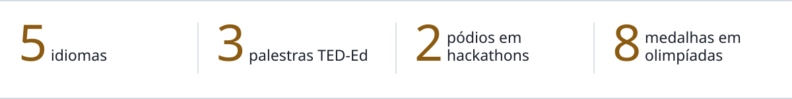
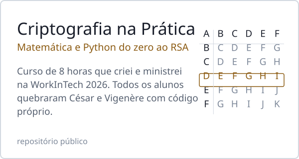
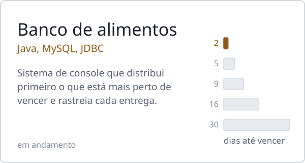
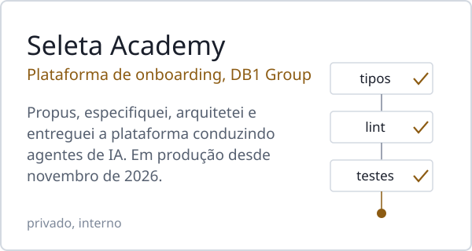
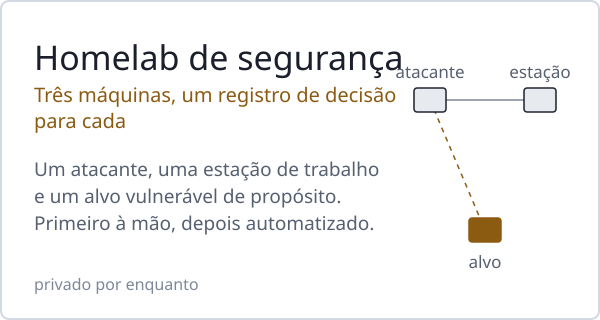

<picture><source media="(prefers-color-scheme: dark)" srcset="assets/pt/header-dark.svg"></picture>

<a href="https://github.com/BrunoFernandesO">English</a> · <b>Português</b> · <a href="https://github.com/BrunoFernandesO/BrunoFernandesO/blob/main/README.es.md">Español</a> 
<a href="https://www.linkedin.com/in/bruno-fernandes-ortega">LinkedIn</a> · <a href="http://lattes.cnpq.br/2238488248240559">Lattes</a>

Nasci no Chile e morei no Chile, nos Estados Unidos e no Brasil. Projeto sistemas, conduzo agentes de IA para construí-los e ensino o que aprendo.

<picture><source media="(prefers-color-scheme: dark)" srcset="assets/pt/facts-dark.svg"></picture>

### Trabalhos em destaque

<a href="https://github.com/BrunoFernandesO/CTF-Cryptography"><picture><source media="(prefers-color-scheme: dark)" srcset="assets/pt/card-course-dark.svg"></picture></a>
<a href="https://github.com/BrunoFernandesO/banco-de-alimentos-aep"><picture><source media="(prefers-color-scheme: dark)" srcset="assets/pt/card-foodbank-dark.svg"></picture></a>
<picture><source media="(prefers-color-scheme: dark)" srcset="assets/pt/card-academy-dark.svg"></picture>
<picture><source media="(prefers-color-scheme: dark)" srcset="assets/pt/card-homelab-dark.svg"></picture>

### Agora

- Estudando álgebra linear como parte da preparação para o mestrado.
- Fazendo as trilhas do TryHackMe e montando o homelab acima, um registro de decisão por vez.

### Experiência

- **Estagiário de Operações de Marketplace**, Marca Seleta · DB1 Group (out. 2025 – atual). Cuido de ponta a ponta da carteira de clientes LATAM de língua espanhola, criei uma automação de precificação para marketplaces em n8n e encontrei e corrigi falhas de segurança em uma aplicação interna de IA.
- **Diretoria Científica**, Axion, organização estudantil de tecnologia da UniCesumar. Coorganizei a WorkInTech 2026 (mais de 300 participantes) e represento a Engenharia de Software em ações com alunos do ensino médio.
- **Fundador**, UniEnglish, programa semanal de conversação em inglês para estudantes (mais de 15 participantes).
- **Membro**, Liga Azul de Robótica, projeto de extensão em robótica da UniCesumar.

### Reconhecimentos

- 2º lugar entre 30 equipes, Hackathon UniCesumar × Elotech 2026 (líder da equipe)
- 2º lugar entre 22 equipes, 6º Hackathon Inova Agro 2025 (líder da equipe)
- Bolsa integral na UniCesumar, conquistada por olimpíadas científicas nacionais; ouro na Olimpíada Nacional de Ciências (ONC)
- Certificado de Desempenho Acadêmico, UniCesumar (2026)
- AI First Certification, DB1 Group (2026)
- Palestras TED-Ed: [línguas e identidade](https://youtu.be/3qbNDMw_4qs) (2024), [a evolução dos modelos atômicos](https://www.youtube.com/watch?v=iRVyXAUh6aY) (2022), [Darwin e a teoria da evolução](https://www.youtube.com/watch?v=YqmxHsZdLtg) (2021, em espanhol)

### Ferramentas

Java · C · SQL · HTML · CSS · JavaScript · Linux · Git 
Também automatizo fluxos com n8n e desenvolvo com agentes de IA (Claude Code) a partir de especificações e registros de decisão escritos.

Os gráficos desta página são gerados por [`tools/build_assets.py`](tools/build_assets.py) e compostos em Latin Modern, a fonte do LaTeX.
